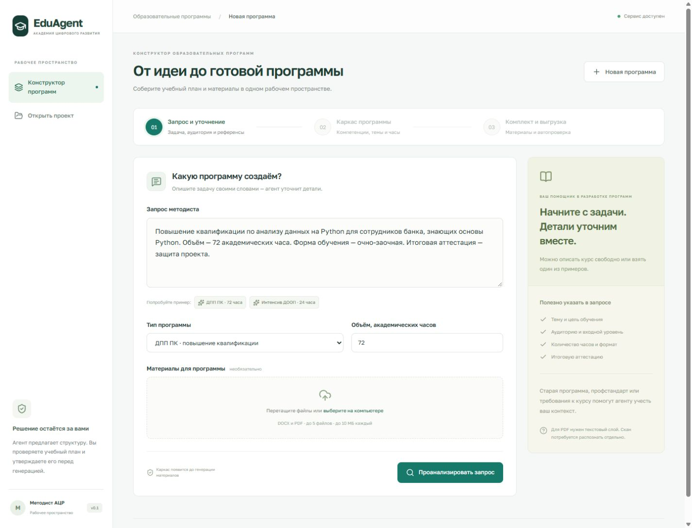
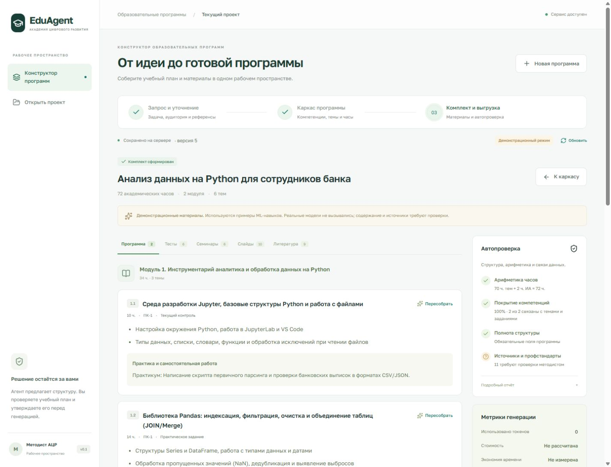

# Интерфейс методиста

React + TypeScript + Vite. Интерфейс вызывает API из `backend/` и показывает
сохранённые сервером данные. Функции генерации и экспорта выполняет бэкенд.

## Локальный запуск в Windows

Нужны Python для бэкенда и Node.js 22.12 или новее. Интерфейс проверен
с Node.js 24. Зафиксированные зависимости находятся в `package-lock.json`.

Первый терминал, из корня репозитория после установки Python-зависимостей
по [основной инструкции](../README.md):

```powershell
.\.venv\Scripts\python.exe -m uvicorn backend.main:app --reload --port 8000
```

Второй терминал, также из корня репозитория:

```powershell
Set-Location frontend
npm ci
npm run dev
```

Откройте <http://127.0.0.1:5173>. Индикатор «Сервис доступен» подтверждает
ответ `/api/health`. Vite передаёт запросы `/api` на `http://127.0.0.1:8000`.
Если порт 5173 занят, запуск завершится ошибкой вместо незаметной смены адреса.

## Путь методиста

1. **Запрос и уточнение.** Введите задачу или выберите ДПП ПК на 72 часа /
   интенсив ДООП на 24 часа. При необходимости прикрепите DOCX/PDF
   (до пяти файлов, до 10 МБ каждый). Ответьте на вопросы анализа и создайте
   каркас. При изменении исходного запроса анализ нужно выполнить заново.
2. **Каркас программы.** Проверьте карту компетенций, профстандарты, знания,
   умения и практический опыт. Названия программы, модулей и тем, цель,
   общий объём, часы аттестации и часы ЛК/ПР/ЛБ/СР редактируются вручную.
   Несовпадение суммы часов блокирует утверждение. Кнопка утверждения сначала
   сохраняет план, затем запускает генерацию материалов.
3. **Комплект и выгрузка.** Просмотрите отчёт автопроверки и пять вкладок:
   рабочая программа, тесты с ключами, семинары, слайды, литература.
   Пересоберите выбранную тему или вопрос с собственной инструкцией.
   Скачайте DOCX, PPTX, GIFT, JSON или CSV.





## Сохранение и повторное открытие

Проект хранится бэкендом в `data/projects/<id>.json`. В браузере сохраняются
ID последнего проекта и параметры его запроса. Страница с `?project=<id>`
или кнопка «Открыть проект» загружают актуальную серверную версию.
Перезагрузка страницы не запускает генерацию повторно.

Редактор помечает несохранённые правки. Перед их заменой или переключением
проекта появляется подтверждение. Сервер контролирует `revision`: при
конфликте интерфейс сохраняет текущий черновик и предлагает загрузить
актуальную версию. Нажатие «Обновить» после подтверждения заменяет черновик.
Новая программа не удаляет предыдущий проект с сервера.

Утверждение изменённого каркаса сбрасывает ранее созданные материалы;
интерфейс предупреждает об этом перед повторной генерацией. Пересборка темы
и пересборка вопроса используют отдельный серверный маршрут.

## Подключение API и сборка

По умолчанию используется `/api` на текущем адресе сайта. Для отдельного
публичного адреса API скопируйте `.env.example` в `.env.local` и задайте
`VITE_API_BASE`, например `http://127.0.0.1:8000` (без `/api` в конце).
Для другого origin настройте `CORS_ORIGINS` бэкенда. Перезапустите Vite после
смены переменных. Значения `VITE_*` доступны посетителю сайта: ключи модели
должны оставаться только в окружении бэкенда.

```powershell
npm run build
npm run preview
```

Сборка выполняет проверку TypeScript и создаёт `dist/`. Локальный просмотр
сборки доступен на <http://127.0.0.1:4173> и тоже проксирует `/api` на порт 8000.
При размещении в Cloud.ru статический сервер должен отдавать `dist/`,
а `/api` направлять на FastAPI; либо задайте публичный `VITE_API_BASE`
до сборки. Развёртывание в Cloud.ru в эту проверку не входило.

Шрифты поставляются локально. Кнопки выгрузки получают файлы из API, включая
проверку версии проекта. Точные тела запросов описаны в
[документации бэкенда](../backend/README.md); вызовы находятся в `src/api.ts`.

## Что подтверждено

Работа с живым локальным FastAPI проверена в браузере: два типа программ,
уточнения, загрузка DOCX/PDF, правка часов, генерация, точечная пересборка,
пять выгрузок, восстановление проекта и конфликт версий. Проверена мобильная
ширина 390 px. Подробности — в [чек-листе проверки](../docs/FRONTEND_CHECKLIST.md).

Сейчас локальный бэкенд работает в `ML_MODE=demo`. Содержимое курса берётся
из демоданных ML-ветки; это подтверждение интеграции. Качество реальной
генерации и работа с платной моделью Cloud.ru требуют отдельной проверки.
Отчёт показывает непроверенные источники. Стоимость и сэкономленное время
не выдумываются: при отсутствии серверных метрик отображается отсутствие
расчёта. Импорт GIFT в целевую Moodle и визуальная приёмка DOCX в Word
пока не выполнены.
